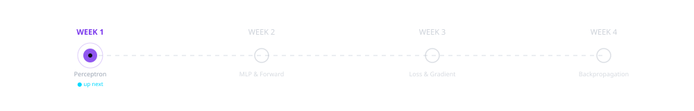

<div align="center">

<picture>
  <source srcset="assets/hero.svg" media="(prefers-color-scheme: dark)">
  <source srcset="assets/hero.svg" media="(prefers-color-scheme: light)">
  
</picture>

<br/>

[](https://www.python.org/)
[](https://numpy.org/)
[](https://matplotlib.org/)
[](https://seaborn.pydata.org/)
&nbsp;&nbsp;`Semester 5 · ANN & Deep Learning`

</div>

---

## Mission

> [!IMPORTANT]
> **Semester Midterm Archive & Study Blueprint:**
> The complete midterm curriculum (Lectures 01 to 08, Convolutional Architectures, Adaptive Optimizers & Fuzzy Logic) is consolidated in:
> 👉 **[`DEEP_LEARNING_MIDTERM_GUIDE.md`](DEEP_LEARNING_MIDTERM_GUIDE.md)**
> Includes Muhammad Arsalan's AI Learning Strategy (`FIRST LEARN → THEN UNDERSTAND → THEN APPLY → THEN BUILD`), high-yield derivations, formula cheat-sheets, and a complete solved midterm examination benchmark paper.


This is my semester-long lab notebook for Artificial Neural Networks & Deep Learning.
The goal is to understand every mathematical detail — from the perceptron to backpropagation — before touching any framework.
Nothing here is copied. If it is in this repo, I worked through it myself.

---

<div align="center">

<picture>
  <source srcset="assets/roadmap.svg" media="(prefers-color-scheme: dark)">
  <source srcset="assets/roadmap.svg" media="(prefers-color-scheme: light)">
  
</picture>

</div>

| Week | Topic | Status |
|:----:|:------|:------:|
| **1** | Perceptron, linear separability & activation functions | 🔴 up next |
| **2** | Multi-Layer Perceptron (MLP) & forward propagation | ○ planned |
| **3** | Loss functions & gradient descent mathematics | ○ planned |
| **4** | The backpropagation algorithm from scratch | ○ planned |

> **Honesty note:** All four modules are marked "Not Learned" in my progress tracker.
> This repo is scaffolded and ready — the learning starts now.

---

## What's Already Here

| Folder | Contents |
|:-------|:---------|
| [`DEEP_LEARNING_MIDTERM_GUIDE.md`](DEEP_LEARNING_MIDTERM_GUIDE.md) | Flagship Midterm Guide, 7-Step AI Study Strategy & Solved Mock Paper |
| [`personal-notes/`](personal-notes/) | Study notes (`notes.md`), cheat-sheet (`reference.md`), and `AI_LEARNING_STRATEGY.md` |
| [`connections-to-ai-robotics/`](connections-to-ai-robotics/) | Two bridge docs: how deep learning maps to robotics perception and agent policies |
| [`lecture-notes/`](lecture-notes/) | Placeholder — will hold derivations and proofs |
| [`assignments/`](assignments/) | Placeholder — semester problem sets |
| [`quizzes/`](quizzes/) | Placeholder — retrieval practice tests |
| [`projects/`](projects/) | Placeholder — from-scratch model implementations |
| [`presentations/`](presentations/) | Placeholder — slide decks |
| [`progress-tracker/`](progress-tracker/) | Weekly status and confidence log |

---


## Deep Learning Labs

Interactive Google Colab notebooks for hands-on deep learning experiments:

| Lab | Description | Notebook | Open in Colab |
|:---:|:------------|:---------|:-------------:|
| **Lab 1** | Foundational ANN Implementation | ⏳ Arriving | — |
| **Lab 2** | MLP Forward & Backpropagation | ⏳ Arriving | — |
| **Lab 3** | Adaptive Optimizers (ANN / MLP) | [`Lab3_Adaptive_Optimizers_ANN_MLP.ipynb`](labs/Lab3_Adaptive_Optimizers_ANN_MLP.ipynb) | [](https://colab.research.google.com/github/24pwai0015-max/ann-and-deep-learning/blob/main/labs/Lab3_Adaptive_Optimizers_ANN_MLP.ipynb) |
| **Lab 4** | Adaptive Optimizers (CNN) | [`Lab4_Adaptive_Optimizers_CNN.ipynb`](labs/Lab4_Adaptive_Optimizers_CNN.ipynb) | [](https://colab.research.google.com/github/24pwai0015-max/ann-and-deep-learning/blob/main/labs/Lab4_Adaptive_Optimizers_CNN.ipynb) |
| **Lab 5** | Batch vs. Stochastic vs. Mini-Batch | [`Lab5_Batch_vs_Stochastic_vs_MiniBatch.ipynb`](labs/Lab5_Batch_vs_Stochastic_vs_MiniBatch.ipynb) | [](https://colab.research.google.com/github/24pwai0015-max/ann-and-deep-learning/blob/main/labs/Lab5_Batch_vs_Stochastic_vs_MiniBatch.ipynb) |

---

## Planned Skills

What I will be implementing from scratch over the semester.

| Foundations | Architectures | Optimization | Tooling |
|:------------|:--------------|:-------------|:--------|
| Perceptron | Multi-layer perceptron | Gradient descent | NumPy |
| Activation functions | Forward propagation | Backpropagation | Matplotlib |
| Linear separability | Loss functions | Chain rule derivations | Seaborn |

---

## Repository Map

```
ann-and-deep-learning/
├── assets/
│   ├── hero.svg                          ← animated neural network banner
│   └── roadmap.svg                       ← course timeline
├── labs/
│   ├── README.md                         ← index of all labs & deliverables
│   ├── Lab3_Adaptive_Optimizers_ANN_MLP.ipynb      ← Lab 3: Adaptive Optimizers in ANN/MLP
│   ├── Lab4_Adaptive_Optimizers_CNN.ipynb          ← Lab 4: Adaptive Optimizers in CNN
│   ├── Lab5_Batch_vs_Stochastic_vs_MiniBatch.ipynb ← Lab 5: Batch vs Mini-batch vs SGD
│   ├── handouts/                         ← official lab task sheets
│   └── delivered-reports/                ← evaluated PDF submissions
├── DEEP_LEARNING_MIDTERM_GUIDE.md        ← Master Midterm Guide & Solved Exam Paper
├── personal-notes/
│   ├── AI_LEARNING_STRATEGY.md           ← Arsalan's 7-step study workflow & philosophy
│   ├── notes.md                          ← Concepts, worked examples & proof derivations
│   ├── reference.md                      ← Quick-reference formula & syntax cheat-sheet
│   ├── intro to ann.pdf                  ← first reading notes
│   └── README.md
├── connections-to-ai-robotics/
│   ├── deep-learning-robotics-perception.md
│   └── neural-networks-agent-policies.md
├── lecture-notes/
│   └── README.md
├── assignments/
│   └── README.md
├── quizzes/
│   └── README.md
├── projects/
│   └── README.md
├── presentations/
│   └── README.md
├── progress-tracker/
│   └── README.md
├── progress-tracker.md                   ← Mids Academic Progress Tracker (Lectures 01–05)
├── .gitignore
├── requirements.txt
└── README.md                             ← you are here
```

---

## Quick Start (Windows PowerShell)

```powershell
# 1  Clone
git clone https://github.com/24pwai0015-max/ann-and-deep-learning.git
cd ann-and-deep-learning

# 2  Virtual environment
python -m venv .venv
.\.venv\Scripts\Activate.ps1

# 3  Dependencies
pip install -r requirements.txt
```

---

## How I Learn

1. **Read** the math first — no code until the derivation makes sense on paper.
2. **Derive** every equation by hand in `personal-notes/`.
3. **Implement** from scratch using only NumPy — no frameworks allowed initially.
4. **Visualise** loss curves, decision boundaries, and gradient flow with Matplotlib.
5. **Document** what confused me and what clicked in `lecture-notes/`.

---

## Current Focus & Next Steps

- **Now:** reading perceptron theory and preparing Week 1 notes.
- **Next:** implement a single-layer perceptron from scratch in NumPy with a decision-boundary plot.
- **After that:** MLP forward pass, then loss functions, then the full backprop derivation.

---

## Bridge to AI & Robotics

This course connects directly to my longer-term interest in autonomous agents:

- [Neural Networks for Agent Policies](connections-to-ai-robotics/neural-networks-agent-policies.md) — DQN, Actor-Critic, latent embeddings.
- [Deep Learning in Robotics Perception](connections-to-ai-robotics/deep-learning-robotics-perception.md) — CNNs for vision, PointNet for LiDAR, edge inference.

---

<div align="center">

<sub>Made with patience by <a href="https://github.com/24pwai0015-max">Arsalan</a> · BS AI · UET Peshawar</sub>

</div>
